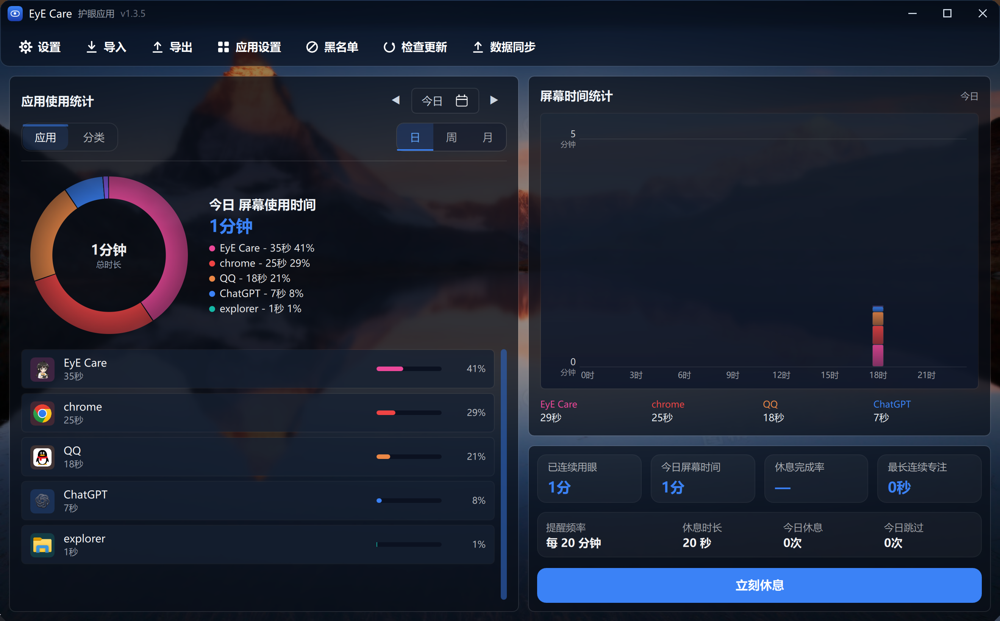

# EyE Care

Windows 10/11 护眼提醒与使用时长统计工具。帮你记下每天的用眼时间，也提醒你停下来休息。

## 开始使用

从 [下载页](https://github.com/Suisyokuyuu/Eye-care/releases/tag/latest) 下载 Windows x64 ZIP，**完整解压**后双击 `EyE Care.exe`，无需安装 Python。

## 常用功能

| 想做什么 | 怎么操作 |
|---|---|
| 调整护眼提醒 | 打开“设置”，调整休息间隔、时长与提示音，点“应用”。想马上休息可点“立刻休息”。 |
| 查看使用时长 | 在主界面切换日期、周或月，查看应用、分类统计；网站统计需在设置中开启。 |
| 暂停提醒或计时 | 右键托盘图标，选择“勿扰”或“离开”；选择“正常”恢复。 |
| 整理应用 | 在“应用设置”中调整分类；不希望统计的应用可加入黑名单。 |
| 更换背景 | 在“设置”底部选择背景图，用滑条调整变暗、模糊与面板透明度，点“应用”。 |
| 备份与恢复 | 工具栏“导出”保存完整数据 ZIP，“导入”用于恢复；建议恢复前先备份。 |
| 给 AI 看汇总 | 打开“数据同步”，选择日期范围后“导出 JSON”，或配置自己的 Notion 后点“立即同步”。 |
| 获取更新 | 点击“检查更新”，按提示下载并重启升级。 |

关闭主窗口时可选择留在托盘；彻底结束请右键托盘图标选“退出”。找不到图标时，先查看任务栏右下角的“显示隐藏的图标”（小箭头）。

## 同步到自己的 Notion

创建 Notion API 连接，将自己的页面授权给它，再在“数据同步”填写 API 密钥和页面链接。同步按日期与设备更新每日汇总，同一天重复同步会更新原记录。可手动同步，也可开启“启动后同步一次”或“每天定时同步”。

详细步骤见 [Notion 配置手册](docs/notion-guide.html)（下载后用浏览器打开），其他操作见 [使用手册](使用手册.md)。密钥只在软件中填写；分享截图、数据文件前请先检查个人信息。

许可证：[MIT](LICENSE)。
